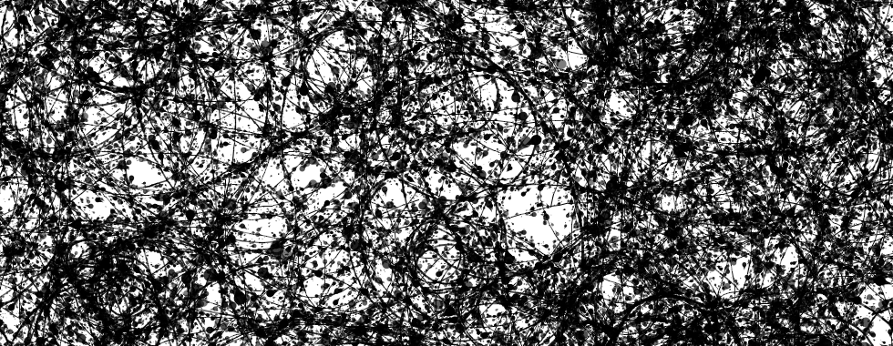
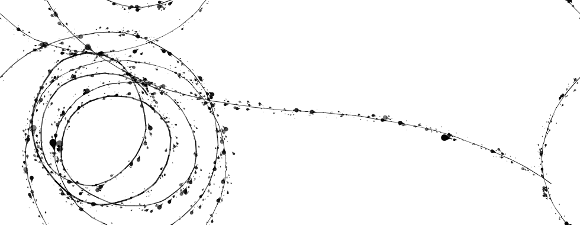
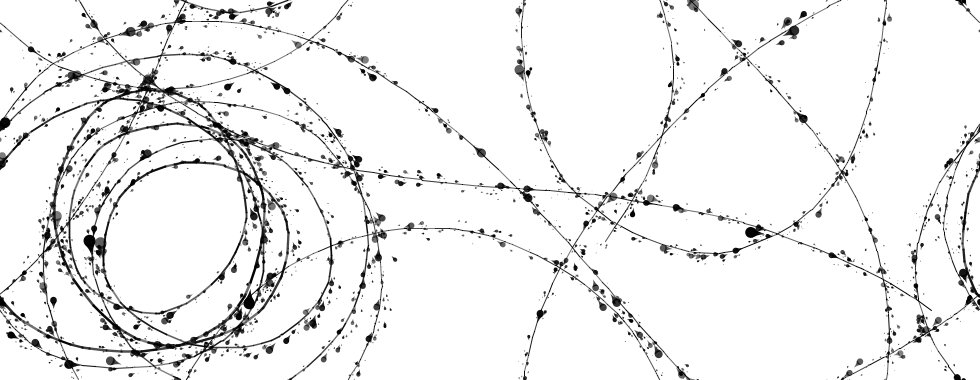
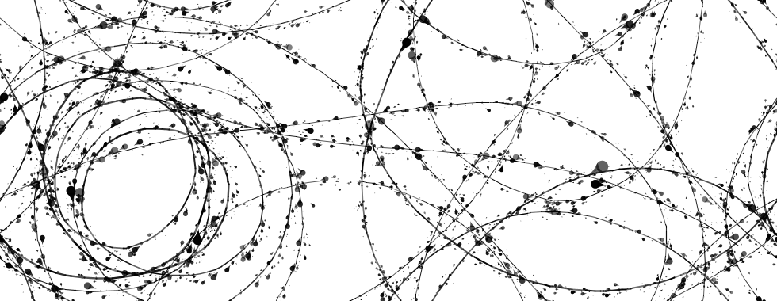
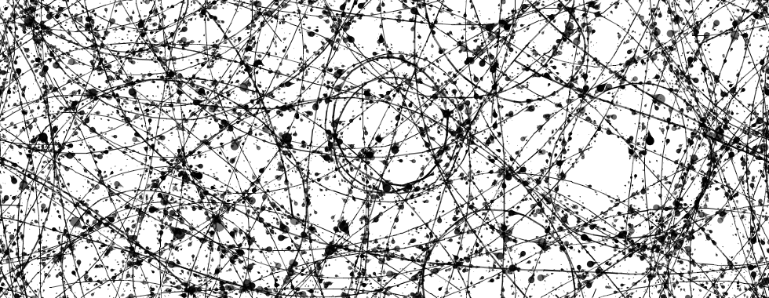
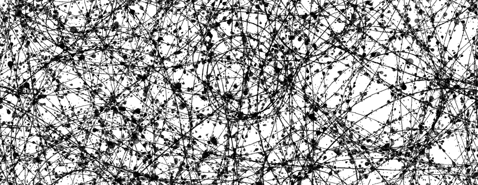
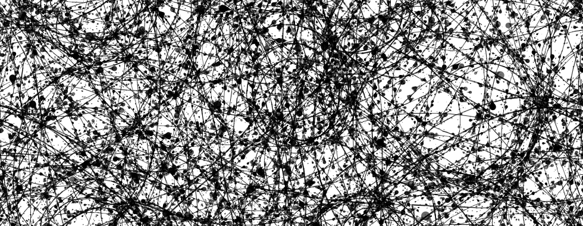
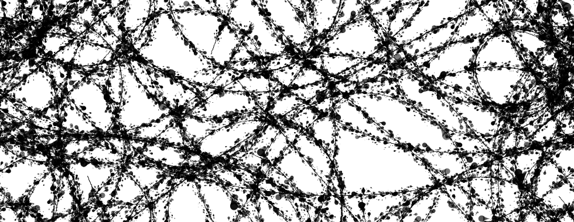

If you're here for the picture, you can skip the rambling thoughts about AI and jump to [this section](#never-mind-ai-its-the-pollocks).

## Is anyone else bored by AI yet?
I continue not posting much this year, and I think that like everything else in 2026 it is because of AI. I am find it increasingly hard to see the point of posting examples of human-written code, with somewhat pedagogic intent, when seemingly all the code anyone cares about any more is AI-generated. There are other reasons too, such as being busy with a couple of major projects that have taken up a lot of my time. 

But when I've been less busy with those projects, I've been more busy keeping up with the AI a colleague is using to develop a [QGIS plugin for our tiled and woven multivariate maps work](https://github.com/FoldingSpace/weavingspaceQGIS/).^[So, there you go: it's the AI again.] It's instructive how that side-project has gone lately. 

### The upside
We went from no plugin to an essentially working plugin in an afternoon. Seriously: this part was impressive.

Then the AI started finding inefficiencies in my lovingly hand-crafted-over-three-or-four-years [`weavingspace`](https://github.com/DOSull/weavingspace) codebase. Still impressive, but much less welcome. The AI would 'patch' these inefficiencies in the version of `weavingspace` it delivers to the QGIS plugin. Meanwhile, I was asked to consider 'upstreaming' the patches into the source.

The annoying thing is the suggestions made sense. A couple were obvious. Probably the kind of things that in a more performance-critical setting (which this really isn't) would have been picked up somewhere along the way by some human. Others were less obvious. The kind of low-level speedups that it would never have occurred to me to bother with, unless I was trying (which I wasn't) to eke out every last ounce of performance from the code, and often hinging on the kind of [`pandas`](https://pandas.pydata.org/) API arcana that only an AI could know about. Anyway, I decided to take the plunge and the net result is that there are now some short sections of the `weavingspace` code fenced off between

    # ---AI-suggested-code-starts---

and 

    # ---AI-suggested-code-ends---

comments, and I honestly have no idea how I feel about this. On the one hand, it seems important to be upfront about the AI assistance; on the other hand, I don't rarely acknowledge learning things from API documentation. Is it any different? I don't know, but it _feels_ different. 

My colleague (with less of a stake in the purity of the `weavinspace` code itself) thinks that all of this is an unambiguously good thing. And it's true, we have a QGIS plugin for the `weavingspace` codebase that we _could_ have built eventually, but which we never _would_ have built&mdash;not if we're honest.^[Obligatory em-dash: yes, I am a human.] I've even given a [talk about it](https://geospatialstuff.com/weavingspace/presentations/NZCS-Aug-2026/#/title-slide). The plugin is also a lot more capable and polished than we'd ever have built, if we'd ever gotten round to it (which we wouldn't). So, yeah, that's all definitely a plus. 

### The downside
Less of a plus is that it's not clear to me that either of us could ever maintain the plugin code, or even ever become sufficiently well-versed in its workings to guess whereabouts a newly unearthed bug is likely to reside. It's a very uncomfortable feeling to have put something into the world, ostensibly made by us, which I really don’t understand. We can maintain it using the AI, but, even setting to one side the economics of that when the AI vendors inevitably have to monetise their product to justify their valuations, that's not the point: it feels _existentially bad_ to be in this situation, at least for me, for some reason that I don't fully understand.

The other thing is that at times it's felt like I am working for the AI, and not the other way around. For a start there was upstreaming those minor efficiency gains noted above. But the feeling that the AI is calling the shots has intensified more recently as we've started to look into including tiling topology in the plugin. There has been 'topology' in the Python codebase for a while.^[As [this notebook](https://github.com/DOSull/weavingspace/blob/main/examples/topology-working.ipynb) shows.] Its _outrageously_ poor performance has not been an issue until now, because identifying a tiled pattern's topological structure and modifying it has been something we did in code in a a notebook, not interactively in a plugin. But now we'd like to make it interactive and that poor performance has become a problem.

Our ~~alien~~AI ~~overseer~~assistant had some suggestions for a more efficient way to identify the symmetries of a tiling than my previous exhaustive search approach. I took the ideas on board and now in the experimental branch of the code there's a [more-or-less-working implementation](https://github.com/DOSull/weavingspace/blob/experimental/examples/topology-new-working.ipynb) using the core ideas. I've had to come up with a lot of the details myself, and it doesn't (yet) do everything required, but the end is in sight, and it is a lot quicker. A lot of people, I sense, having asked the AI for suggestions how to make the code more efficient, after broadly agreeing the approach would have issued a [Picard-ian "make it so"](https://www.startrek.com/en-un/news/picard-poll-make-it-so), and not now be slightly exasperated with themselves for having spent time making it not quite so. The problem is I want `weavingspace` to remain my code, and it feels to me (still) that I have to do the work for that to be the case.

### What I still don't get about AI
The thing is _I enjoy_ writing code. I enjoy solving the myriad puzzles writing code throws at me. I also enjoy the feeling of building a complicated thing that works, that I understand, and which, if called upon, I could explain to another interested human being. That's why I feel the need to fence off the parts of the `weavingspace` code that the AI made suggestions for. Soon enough I'll have to figure out a form of words to describe its contribution to the new topology code too. Because I am absolutely committed still to `weavingspace` remaining a 100% human-made product. I don't know why I feel this way, I just do. `¯\_(ツ)_/¯`

Anyway, that's where I'm at with AI as of October 2026: a somewhat reluctant oh alright then late adopter at one step remove (since it's my colleague doing the prompting not me). In spite of my reservations, when a project comes along where I really have to use it, I will. Perhaps it will feel different to build something from scratch with AI, and not have it 'pollute' the purity of an established codebase.

Anyhoo... that's quite enough ranting for one post.

## Never mind AI, here's the Pollocks!
Anyone visiting this site for slightly daft code-based content of a spatial and visual nature, this section's for you.

Here's a [digital thing](pollock.nlogox) I made by hand (right-click `Save as...` to download it). It took almost no time to make. It serves no purpose, and it doesn't need to be anything more than it is. I made it for the sheer fun of figuring out how. Here's an example of the images it can make:



You'll need [Netlogo](https://netlogo.org) to run the file, but here's the code in its entirety.

```
extensions [
  palette
]

turtles-own [
  d-heading
  dd-heading
]

to setup
  clear-all
  ask patches [
    set pcolor white
  ]
  create-turtles n-turtles [
    setxy random-xcor random-ycor
    set color black
    set shape "drop"
    set size 0.1
    set dd-heading random-normal 0 wiggliness
    set d-heading random-normal 0 1
    pd
  ]
  reset-ticks
end

to go
  ask turtles [
    set dd-heading random-normal 0 wiggliness
    set d-heading d-heading + dd-heading
    rt d-heading
    set pen-size max (list 0.01 (pen-size + random-normal 0 0.05))
    fd 0.05 + random-float speed-variability
    splotch
  ]
  tick
end

to splotch
  let x0 xcor
  let y0 ycor
  let heading0 heading
  pu
  let n random 3 + random-poisson 2
  (foreach n-values n [i -> random-normal dx 0.2] n-values n [i -> random-normal dy 0.2] [ [x y] ->
    facexy x0 + x y0 + y
    setxy x0 + x y0 + y
    set size 0.05 + random-exponential 0.15
    set color color palette:with-alpha (128 + random 128)
    stamp
    setxy x0 y0
  ])
  set heading heading0
  pd
end
```

I expect that I could have 'written' this in 30 seconds using AI. But where would the fun be in that?

Anyway, the linked file above includes a (very limited) UI with controls that let you vary the results in various ways, as seen in the examples below.

 {width=48% style="margin-right:5px;"}{width=48% style="margin-left:5px;"}
{width=48% style="margin-right:5px;margin-top:10px;"}{width=48% style="margin-left:5px;margin-top:10px;"}
{width=48% style="margin-right:5px;margin-top:10px;"}{width=48% style="margin-left:5px;margin-top:10px;"}
{width=48% style="margin-right:5px;margin-top:10px;"}{width=48% style="margin-left:5px;margin-top:10px;"}

